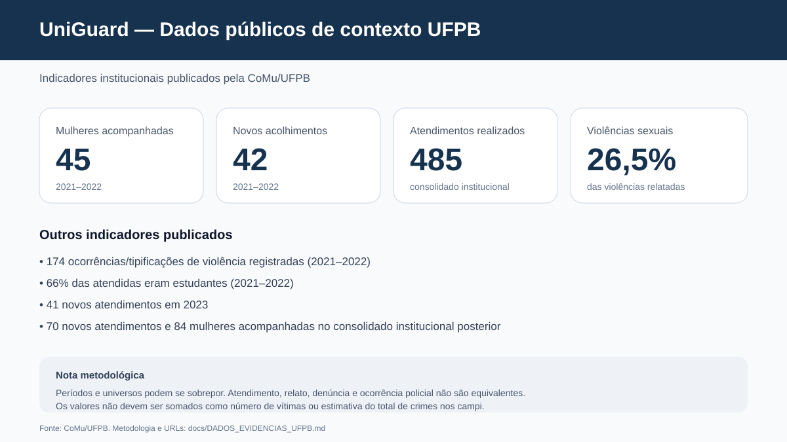

# 🛡️ UniGuard — Segurança Universitária Georreferenciada

> **POC Flutter + Kotlin em revisão:** consulte [`LEIA_PRIMEIRO_FLUTTER.md`](LEIA_PRIMEIRO_FLUTTER.md).
> A tela de histórico usa dados fictícios e fica isolada por build opt-in, com SOS bloqueado nesse build. O CI do PR executa a análise, os testes Flutter e builds comparativos; validação em dispositivo segue pendente.


> **Versão atual: v0.9.0 — pré-validação institucional.**
>
> **Estágio do projeto: intermediário, em evolução para avançado.** O UniGuard não possui integração oficial com a Universidade Federal da Paraíba (UFPB), seus sistemas institucionais, a Superintendência de Segurança, o SAMU ou a Polícia Militar. Usuários, alertas operacionais e fluxos de teste continuam demonstrativos. Já os **indicadores de contexto institucional** apresentados na documentação passam a utilizar dados públicos da CoMu/UFPB, sempre acompanhados de fonte e nota metodológica.

O **UniGuard** é uma proposta de solução digital voltada ao apoio da segurança de estudantes, docentes e servidores em ambientes universitários. O projeto combina aplicativo Android, aplicação web, geolocalização, acionamento de SOS, painel de acompanhamento, integração opcional com Firebase, documentação de segurança, modelagem de dados e artefatos demonstrativos.

🔗 **Protótipo web:** [Acessar o UniGuard](https://uniguardvercelapp.vercel.app/)

🏗️ **Arquitetura:** [Consultar documentação técnica](docs/ARQUITETURA.md)

📋 **Requisitos:** [Consultar requisitos e regras de negócio](docs/REQUISITOS.md)

🔗 **Rastreabilidade:** [Consultar matriz de rastreabilidade](docs/MATRIZ_RASTREABILIDADE.md)

🧪 **Prontidão para piloto:** [Consultar checklist](docs/CHECKLIST_PILOTO.md)

📌 **Status de prontidão:** [Ver matriz consolidada](docs/STATUS_DE_PRONTIDAO.md)

🔎 **Auditoria de código e segurança:** [Consultar revisão de 18/09/2026](docs/AUDITORIA_CODIGO_SEGURANCA_2026-09-18.md)

🛠️ **Plano operacional:** [Consultar plano operacional](docs/PLANO_OPERACIONAL.md)

🧯 **Contingência:** [Consultar plano de contingência](docs/PLANO_CONTINGENCIA.md)

🚨 **Runbook de incidentes:** [Consultar procedimentos](docs/RUNBOOK_INCIDENTES.md)

🔏 **LGPD preparatório:** [Consultar pacote de privacidade](docs/PACOTE_LGPD_PREPARATORIO.md)

🧪 **Matriz de testes:** [Consultar cenários e evidências](docs/MATRIZ_TESTES.md)

🧾 **Checklist de release:** [Consultar critérios de publicação](docs/CHECKLIST_RELEASE.md)

🕵️ **Política de logs:** [Consultar mascaramento e retenção](docs/POLITICA_LOGS_MASCARAMENTO.md)

🧱 **App Check e backend confiável:** [Consultar preparação](docs/APPCHECK_BACKEND.md)

📡 **Monitoramento:** [Consultar plano de observabilidade](docs/MONITORAMENTO_OBSERVABILIDADE.md)

↩️ **Rollback e recuperação:** [Consultar plano](docs/ROLLBACK_RECUPERACAO.md)

🗺️ **Roadmap v0.9:** [Validation & Security](docs/ROADMAP_v0.9.md)

🔐 **Segurança:** [Consultar SECURITY.md](SECURITY.md)

⚠️ **Matriz de riscos:** [Consultar riscos e tratamentos](docs/MATRIZ_RISCOS.md)

🧾 **Histórico de evolução:** [Consultar CHANGELOG.md](CHANGELOG.md)

---

## 📱 Telas e protótipo no Figma

🔗 **Protótipo editável:** [Abrir o UniGuard no Figma](https://www.figma.com/design/HMchmhVu5HFhaoIdmP5p2q/UniGuard?node-id=0-1&p=f&m=draw)

🖼️ **Galeria completa:** [Visualizar as 15 telas individualmente](docs/prototipo-figma/README.md)


> A imagem acima reúne a visão geral do produto. A galeria apresenta separadamente as telas de acesso, configuração, SOS, acompanhamento e recursos complementares. O material representa a visão de produto e pode conter funcionalidades ainda em desenvolvimento.

---

## 🎯 Objetivo

Explorar como recursos de tecnologia, geolocalização e comunicação digital podem contribuir para o registro e o acompanhamento de situações de risco dentro de campi universitários, reduzindo etapas entre o pedido de ajuda e a visualização da ocorrência por uma equipe responsável.

---

## 💭 Por que criei o UniGuard

O UniGuard nasceu da observação de que determinados trajetos em ambientes universitários podem gerar insegurança, especialmente para pessoas que circulam desacompanhadas. Campi extensos, áreas de preservação, iluminação insuficiente e caminhos com pouca circulação podem aumentar essa sensação de vulnerabilidade.

A proposta busca facilitar o pedido de ajuda e permitir que a equipe responsável receba informações essenciais, como localização e horário, com mais rapidez. Essa motivação parte de uma percepção e de experiências de circulação no ambiente universitário e não representa afirmação sobre índices oficiais de criminalidade da UFPB.

---

## 💡 Fluxo da solução

1. O usuário se autentica.
2. Para o fluxo institucional, o e-mail deve estar verificado e o vínculo institucional precisa estar ativo.
3. O sistema identifica a `institutionId` autorizada.
4. O dispositivo solicita as permissões necessárias, como localização e câmera.
5. Em situação de emergência, o usuário aciona o SOS.
6. O alerta reúne categoria, data, hora e localização disponível.
7. Quando autorizada, uma evidência fotográfica pode ser vinculada ao alerta.
8. A Central visualiza apenas alertas da instituição autorizada.
9. Recebimento, visualização e mudanças de status podem gerar registros de auditoria.
10. O alerta é acompanhado até o encerramento.

---

## ✅ O que já está presente no repositório

### Protótipo web

- React 19, TypeScript, Vite e Tailwind CSS;
- alternância entre visão do usuário e Painel de Segurança;
- geolocalização pelo navegador;
- acionamento e categorização do SOS;
- captura de imagem mediante permissão;
- histórico e acompanhamento de alertas;
- mapa interativo;
- modo demonstrativo local quando o Firebase não está configurado.

### Aplicativo Android

- Kotlin e Android SDK;
- tela integrada de SOS;
- Google Maps e Google Play Services Location;
- permissões minimizadas para localização, câmera, internet e SMS;
- estrutura integrada/preparada para Firebase Authentication, Firestore e Storage;
- execução em modo demonstrativo sem configuração Firebase local.

### Segurança e governança

- autenticação por e-mail/senha;
- e-mail verificado para operação institucional;
- autorização por `memberships/{uid}`;
- operadores por `operators/{uid}`;
- isolamento por `institutionId`;
- auditoria append-only para clientes;
- evidências protegidas contra sobrescrita pelo cliente;
- tipos de evidência restritos a JPEG, PNG e WebP nas regras do Storage;
- política de retenção documentada;
- bloqueio de `medicalNotes` e de dados clínicos desnecessários;
- controles locais contra abuso de alertas;
- matriz de riscos com riscos prioritários e bloqueadores de piloto;
- requisitos formais com status de implementação;
- matriz de rastreabilidade entre requisitos, regras, código e documentação;
- checklist de prontidão para piloto com itens bloqueadores;
- plano operacional preparatório;
- plano de contingência para indisponibilidades e degradações;
- runbook de incidentes com severidade, contenção e recuperação;
- pacote LGPD preparatório com inventário de dados, finalidades, retenção, Privacy by Design e fluxo de direitos;
- matriz RACI preparatória para responsabilidades futuras;
- matriz formal de testes com cenários positivos, negativos, contingência e Firebase;
- auditoria de permissões Android com remoção de permissão não utilizada;
- headers de segurança web versionados para a Vercel;
- suíte de Firebase Emulator adicionada ao CI para regras de Firestore e Storage;
- política de logs/mascaramento com utilitário `safeLogger` testado;
- checklist formal de release;
- App Check preparado para web e Android;
- backend confiável em `functions/` com criação de SOS, membership server-side e rate limiting;
- chave de cutover para bloquear escrita direta quando o backend estiver ativo;
- auditor dry-run de dados legados;
- lifecycle de evidências preparado;
- endpoint de health check, plano de monitoramento e rollback;
- fluxo Android legado removido, mantendo apenas o fluxo integrado;
- templates padronizados para bug, melhoria e pull request;
- `CODEOWNERS` com Priscilla Cahino como responsável geral;
- Dependabot para dependências web, Android e GitHub Actions;
- `SECURITY.md`, `CHANGELOG.md` e documentação específica de arquitetura.

### Dados e documentação

- regras do Firestore e Firebase Storage;
- guia de configuração Firebase;
- documentação de auditoria, retenção e abuso;
- requisitos funcionais RF01–RF12;
- requisitos não funcionais RNF01–RNF10;
- regras de negócio RN01–RN12;
- matriz de rastreabilidade;
- checklist de prontidão para piloto;
- modelo relacional MySQL 8+;
- base pública estruturada em CSV para visualizações de contexto;
- documentação metodológica com fontes institucionais e jornalísticas;
- documentação de arquitetura com diagramas Mermaid;
- matriz de riscos em `docs/MATRIZ_RISCOS.md`;
- plano operacional, contingência e runbook de incidentes;
- pacote LGPD preparatório e matriz RACI;
- matriz formal de testes e auditoria de permissões Android.

---

## 🚧 O que ainda depende de validação ou evolução

No estágio atual, as principais pendências estão concentradas na **validação integrada e operacional** dos componentes já desenvolvidos. Antes de qualquer piloto institucional, ainda são necessários, entre outros pontos:

- validação ponta a ponta Android → Firebase → Central;
- validação E2E no projeto Firebase real;
- ativação e comprovação de TTL no Firestore;
- aplicação do ciclo de vida do Firebase Storage;
- registro/enforcement do Firebase App Check;
- deploy do backend confiável e cutover dos clientes;
- testes técnicos de segurança, privacidade, acessibilidade e desempenho;
- formalização jurídica, operacional e institucional;
- procedimentos administrativos para exclusão, incidentes e exceções legais.

📘 O acompanhamento estruturado desses itens está em [`docs/CHECKLIST_PILOTO.md`](docs/CHECKLIST_PILOTO.md).

---

## 🔀 Fluxograma conceitual


---

## 🧩 Arquitetura atual

| Camada | Tecnologias e finalidade |
|---|---|
| Web | React 19, TypeScript, Vite e Tailwind CSS |
| Mapas Web | Leaflet |
| Android | Kotlin, Android SDK, Material Components e Google Maps |
| Geolocalização Android | Google Play Services Location |
| Autenticação | Firebase Authentication |
| Sincronização | Cloud Firestore |
| Evidências | Firebase Storage |
| Isolamento | `institutionId` |
| Modelo relacional | MySQL 8+ para estudo/evolução futura |
| Hospedagem Web | Vercel |
| Dados públicos de contexto | CSV documentado + visualização SVG |

📘 Para a visão detalhada, consulte [`docs/ARQUITETURA.md`](docs/ARQUITETURA.md).

---

## 📋 Engenharia de requisitos

A especificação formal do UniGuard separa requisitos funcionais, não funcionais e regras de negócio, com prioridade e status coerentes com o estado atual do repositório.

- [`docs/REQUISITOS.md`](docs/REQUISITOS.md)
- [`docs/MATRIZ_RASTREABILIDADE.md`](docs/MATRIZ_RASTREABILIDADE.md)

A rastreabilidade liga requisitos a regras de negócio, código, regras Firebase, documentação e validações ainda pendentes.

---

## ⚠️ Gestão de riscos

A matriz de riscos consolida riscos técnicos, de segurança, privacidade, operação e governança, além de indicar controles atuais, tratamento previsto e riscos bloqueadores de um futuro piloto institucional.

📘 Consulte [`docs/MATRIZ_RISCOS.md`](docs/MATRIZ_RISCOS.md).

---

## 📊 Dados públicos, evidências e visualizações

A camada estatística de contexto do UniGuard foi reconstruída para utilizar **dados públicos verificáveis**, sem apresentar números fictícios como se representassem a realidade da UFPB.

### Indicadores de contexto

- **45** mulheres atendidas/acompanhadas pela CoMu entre jan/2021 e nov/2022;
- **42** novos acolhimentos no mesmo período;
- **174** ocorrências/tipificações de violência registradas, considerando que uma mesma pessoa pode relatar múltiplas violências;
- **66%** das atendidas no período 2021–2022 eram estudantes;
- **41** novos atendimentos em 2023;
- no consolidado institucional publicado posteriormente: **485 atendimentos**, **70 novos atendimentos** e **84 mulheres acompanhadas**;
- **26,5%** das violências relatadas no relatório institucional foram classificadas como violências sexuais — estupro, importunação sexual e assédio sexual.

> **Importante:** os períodos e universos dos relatórios não são necessariamente equivalentes e alguns se sobrepõem. Esses valores não devem ser somados para estimar vítimas ou crimes no Campus I.

### Evidência e contexto jornalístico

O projeto também documenta ocorrências publicamente noticiadas para contextualização qualitativa. O relato de violência sexual ocorrido no CCS em fevereiro de 2025 é tratado como **relato/denúncia documentado**, acompanhado do desfecho posteriormente noticiado: a investigação foi arquivada por insuficiência de provas para identificação do autor.

### Fontes e base para gráficos



- 📚 [Metodologia, fontes e evidências públicas](docs/DADOS_EVIDENCIAS_UFPB.md)
- 🗃️ [Base pública estruturada — CSV](docs/dados/UniGuard_Dados_Publicos_UFPB.csv)
- 📊 [Visualização pública — SVG](docs/imagens/UniGuard_Dados_Publicos_UFPB.svg)
- 📄 [CoMu/UFPB — Relatório de Gestão 2021–2022](https://www.ccsa.ufpb.br/comu/contents/documentos/2021-2022_relatorio-gestao-comu.pdf)
- 📄 [CoMu/UFPB — Relatório Anual 2023](https://www.ufpb.br/comu/contents/relatorio-anual-2023.pdf)
- 📄 [CoMu/UFPB — Relatório de Gestão publicado em 2024/2025](https://www.ufpb.br/comu/wp-content/uploads/sites/79/sites/269/2025/03/relatorio-final-1-2024.pdf)
- 📰 [TV Cabo Branco/Globo — atualização sobre o caso do CCS](https://globoplay.globo.com/v/13780593/)

### Separação obrigatória dos dados

**Contexto UFPB:** somente dados públicos e citados.  
**Operação UniGuard:** enquanto não houver piloto real autorizado, deve aparecer como **“Sem dados operacionais reais — protótipo acadêmico”**. Alertas simulados podem continuar existindo apenas para testes funcionais, claramente identificados como DEMO.

> O repositório não contém, neste momento, um arquivo `.pbix`.

---

## 🗄️ Banco de dados

O diretório [`UniGuard_Banco_MySQL`](UniGuard_Banco_MySQL/) contém um modelo relacional compatível com MySQL 8+, criado para representar usuários, dispositivos, campi, contatos de confiança, pontos seguros, alertas, localizações, evidências, equipes, despachos e auditoria.

O modelo relacional representa uma possibilidade de evolução futura e não deve ser acessado diretamente pelo aplicativo ou navegador. Em uma arquitetura real, o acesso deve ocorrer por API/backend seguro.

Consulte as [instruções específicas do banco](UniGuard_Banco_MySQL/README_BANCO.md).

---

## 📁 Organização do repositório

```text
UniGuard/
├── app/                              # Aplicativo Android em Kotlin
├── src/                              # Protótipo web React/TypeScript
├── functions/                        # Backend confiável e auditor de legado
├── infra/                            # Configurações preparatórias de infraestrutura
├── docs/
│   ├── ARQUITETURA.md                # Arquitetura técnica e diagramas
│   ├── REQUISITOS.md                 # RF, RNF e regras de negócio
│   ├── MATRIZ_RASTREABILIDADE.md     # Requisito → código → evidência
│   ├── MATRIZ_RISCOS.md              # Gestão e tratamento de riscos
│   ├── CHECKLIST_PILOTO.md           # Prontidão e bloqueadores do piloto
│   ├── PLANO_OPERACIONAL.md          # Operação preparatória
│   ├── PLANO_CONTINGENCIA.md         # Contingência e recuperação
│   ├── RUNBOOK_INCIDENTES.md         # Resposta a incidentes
│   ├── PACOTE_LGPD_PREPARATORIO.md   # Privacidade e LGPD para futura validação
│   ├── MATRIZ_RACI.md                # Responsabilidades propostas
│   ├── MATRIZ_TESTES.md              # Casos de teste e evidências esperadas
│   ├── AUDITORIA_PERMISSOES_ANDROID.md # Minimização de permissões
│   ├── POLITICA_LOGS_MASCARAMENTO.md    # Logging seguro e mascaramento
│   ├── CHECKLIST_RELEASE.md             # Critérios mínimos de release
│   ├── dados/                        # Base pública UFPB e artefatos legados de demonstração
│   ├── imagens/                      # Imagens e previews principais
│   └── prototipo-figma/              # Galeria das telas
├── UniGuard_Banco_MySQL/             # Modelo relacional e documentação
├── .github/
│   ├── ISSUE_TEMPLATE/               # Templates de bug e melhoria
│   ├── CODEOWNERS                    # Responsabilidade de revisão
│   ├── dependabot.yml                # Atualização de dependências
│   ├── pull_request_template.md      # Checklist de revisão
│   └── workflows/                    # Integração contínua
├── README.md
├── SECURITY.md
├── CHANGELOG.md
├── firebase.json                       # Configuração dos emuladores e regras
├── firestore.rules
├── storage.rules
└── vercel.json                       # Headers de segurança web
```

---

## 🔐 Privacidade, segurança e LGPD

O projeto lida potencialmente com identificação, localização e imagem. Por isso, uma implantação real exige controle de acesso, minimização, retenção limitada, auditoria, resposta a incidentes e validações jurídicas e institucionais.

O UniGuard não deve armazenar prontuário médico. O campo legado `medicalNotes` é bloqueado pelas regras atuais.

Consulte:

- [`SECURITY.md`](SECURITY.md)
- [`docs/REQUISITOS.md`](docs/REQUISITOS.md)
- [`docs/MATRIZ_RASTREABILIDADE.md`](docs/MATRIZ_RASTREABILIDADE.md)
- [`docs/MATRIZ_RISCOS.md`](docs/MATRIZ_RISCOS.md)
- [`docs/CHECKLIST_PILOTO.md`](docs/CHECKLIST_PILOTO.md)
- [`docs/PLANO_OPERACIONAL.md`](docs/PLANO_OPERACIONAL.md)
- [`docs/PLANO_CONTINGENCIA.md`](docs/PLANO_CONTINGENCIA.md)
- [`docs/RUNBOOK_INCIDENTES.md`](docs/RUNBOOK_INCIDENTES.md)
- [`docs/PACOTE_LGPD_PREPARATORIO.md`](docs/PACOTE_LGPD_PREPARATORIO.md)
- [`docs/MATRIZ_RACI.md`](docs/MATRIZ_RACI.md)
- [`docs/MATRIZ_TESTES.md`](docs/MATRIZ_TESTES.md)
- [`docs/AUDITORIA_PERMISSOES_ANDROID.md`](docs/AUDITORIA_PERMISSOES_ANDROID.md)
- [`docs/POLITICA_LOGS_MASCARAMENTO.md`](docs/POLITICA_LOGS_MASCARAMENTO.md)
- [`docs/CHECKLIST_RELEASE.md`](docs/CHECKLIST_RELEASE.md)
- [`docs/CONTROLES_AUDITORIA_RETENCAO_ABUSO.md`](docs/CONTROLES_AUDITORIA_RETENCAO_ABUSO.md)
- [`docs/FIREBASE_SETUP.md`](docs/FIREBASE_SETUP.md)

Não utilize dados pessoais reais durante testes públicos deste protótipo.

---

## 📌 Status do projeto

**Estágio intermediário, em evolução para avançado — v0.9.0, pré-validação institucional.** O repositório apresenta diferentes camadas da solução, funcionalidades implementadas, controles de segurança, testes automatizados e documentação técnica. As principais pendências atuais concentram-se na validação integrada e operacional. O projeto ainda não representa um serviço de emergência disponível para uso real.

> **Importante:** neste repositório, uma funcionalidade marcada como implementada indica que há suporte correspondente no projeto. Isso não equivale automaticamente a validação ponta a ponta, homologação institucional ou prontidão para produção.

---

## 👩‍💻 Responsabilidade geral

**Priscilla Cahino**  
**Responsável geral pelo projeto UniGuard.**

Atuação abrangendo idealização, concepção do produto, definição da proposta de valor, estruturação dos fluxos, requisitos, regras de negócio, prototipação, documentação, organização dos artefatos e consolidação do projeto acadêmico.

- [GitHub](https://github.com/Priscillacahino)
- [Portfólio profissional](https://portfoliopriscilla.vercel.app/)
- [LinkedIn](https://www.linkedin.com/in/priscilla-cahino)

---

### Direitos e uso

O conteúdo autoral, a identidade visual e a documentação do UniGuard não estão autorizados para reprodução, comercialização ou uso institucional sem autorização prévia da autora. Bibliotecas, componentes e recursos de terceiros permanecem sujeitos às respectivas licenças.

Desenvolvido como projeto tecnológico e acadêmico em evolução, com finalidade demonstrativa. 🛡️
