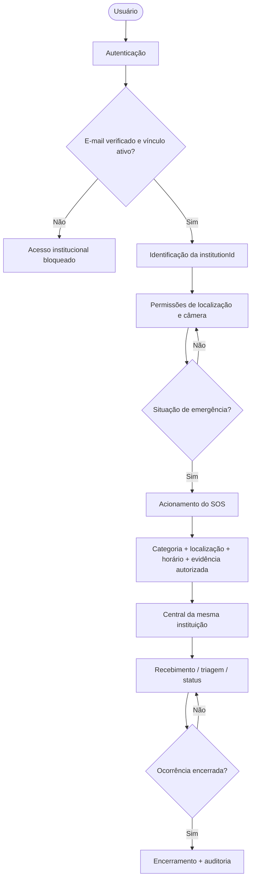
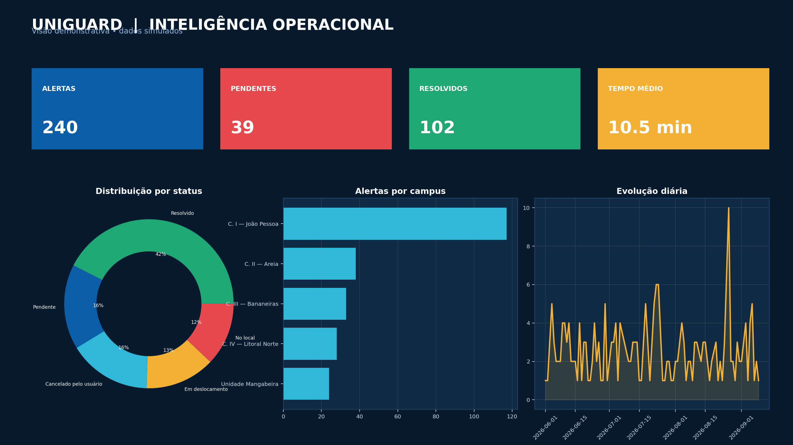

# 🛡️ UniGuard — Segurança Universitária Georreferenciada

> **Protótipo acadêmico em desenvolvimento.** O UniGuard não possui integração oficial com a Universidade Federal da Paraíba (UFPB), seus sistemas institucionais, a Superintendência de Segurança, o SAMU ou a Polícia Militar. Os dados, usuários, mapas, alertas e indicadores apresentados são fictícios e utilizados exclusivamente para demonstração.

O **UniGuard** é uma proposta de solução digital voltada ao apoio da segurança de estudantes, docentes e servidores em ambientes universitários. O projeto combina aplicativo Android, aplicação web, geolocalização, acionamento de SOS, painel de acompanhamento, integração opcional com Firebase, documentação de segurança, modelagem de dados e artefatos demonstrativos.

🔗 **Protótipo web:** [Acessar o UniGuard](https://uniguardvercelapp.vercel.app/)

📄 **Apresentação profissional:** [Visualizar o PDF](docs/apresentacao/UniGuard_Apresentacao_Profissional.pdf)

📊 **PowerPoint:** [Abrir apresentação editável](docs/apresentacao/UniGuard_Apresentacao_Profissional_Atualizada.pptx)

🏗️ **Arquitetura:** [Consultar documentação técnica](docs/ARQUITETURA.md)

🔐 **Segurança:** [Consultar SECURITY.md](SECURITY.md)

⚠️ **Matriz de riscos:** [Consultar riscos e tratamentos](docs/MATRIZ_RISCOS.md)

🧾 **Histórico de evolução:** [Consultar CHANGELOG.md](CHANGELOG.md)

---

## 📱 Telas e protótipo no Figma

🔗 **Protótipo editável:** [Abrir o UniGuard no Figma](https://www.figma.com/design/HMchmhVu5HFhaoIdmP5p2q/UniGuard?node-id=0-1&p=f&m=draw)

🖼️ **Galeria completa:** [Visualizar as 15 telas individualmente](docs/prototipo-figma/README.md)


> A imagem acima reúne a visão geral do produto. A galeria apresenta separadamente as telas de acesso, configuração, SOS, acompanhamento e recursos complementares. O material representa a visão de produto e pode conter funcionalidades ainda em desenvolvimento.

---

## 🎯 Objetivo

Explorar como recursos de tecnologia, geolocalização e comunicação digital podem contribuir para o registro e o acompanhamento de situações de risco dentro de campi universitários, reduzindo etapas entre o pedido de ajuda e a visualização da ocorrência por uma equipe responsável.

---

## 💭 Por que criei o UniGuard

O UniGuard nasceu da observação de que determinados trajetos em ambientes universitários podem gerar insegurança, especialmente para pessoas que circulam desacompanhadas. Campi extensos, áreas de preservação, iluminação insuficiente e caminhos com pouca circulação podem aumentar essa sensação de vulnerabilidade.

A proposta busca facilitar o pedido de ajuda e permitir que a equipe responsável receba informações essenciais, como localização e horário, com mais rapidez. Essa motivação parte de uma percepção e de experiências de circulação no ambiente universitário e não representa afirmação sobre índices oficiais de criminalidade da UFPB.

---

## 💡 Fluxo da solução

1. O usuário se autentica.
2. Para o fluxo institucional, o e-mail deve estar verificado e o vínculo institucional precisa estar ativo.
3. O sistema identifica a `institutionId` autorizada.
4. O dispositivo solicita as permissões necessárias, como localização e câmera.
5. Em situação de emergência, o usuário aciona o SOS.
6. O alerta reúne categoria, data, hora e localização disponível.
7. Quando autorizada, uma evidência fotográfica pode ser vinculada ao alerta.
8. A Central visualiza apenas alertas da instituição autorizada.
9. Recebimento, visualização e mudanças de status podem gerar registros de auditoria.
10. O alerta é acompanhado até o encerramento.

---

## ✅ O que já está presente no repositório

### Protótipo web

- React 19, TypeScript, Vite e Tailwind CSS;
- alternância entre visão do usuário e Painel de Segurança;
- geolocalização pelo navegador;
- acionamento e categorização do SOS;
- captura de imagem mediante permissão;
- histórico e acompanhamento de alertas;
- mapa interativo;
- modo demonstrativo local quando o Firebase não está configurado.

### Aplicativo Android

- Kotlin e Android SDK;
- tela integrada de SOS;
- Google Maps e Google Play Services Location;
- permissões para localização, câmera, internet, SMS e vibração;
- estrutura integrada/preparada para Firebase Authentication, Firestore e Storage;
- execução em modo demonstrativo sem configuração Firebase local.

### Segurança e governança

- autenticação por e-mail/senha;
- e-mail verificado para operação institucional;
- autorização por `memberships/{uid}`;
- operadores por `operators/{uid}`;
- isolamento por `institutionId`;
- auditoria append-only para clientes;
- evidências protegidas contra sobrescrita pelo cliente;
- política de retenção documentada;
- bloqueio de `medicalNotes` e de dados clínicos desnecessários;
- controles locais contra abuso de alertas;
- matriz de riscos com riscos prioritários e bloqueadores de piloto;
- templates padronizados para bug, melhoria e pull request;
- `CODEOWNERS` com Priscilla Cahino como responsável geral;
- Dependabot para dependências web, Android e GitHub Actions;
- `SECURITY.md`, `CHANGELOG.md` e documentação específica de arquitetura.

### Dados e documentação

- regras do Firestore e Firebase Storage;
- guia de configuração Firebase;
- documentação de auditoria, retenção e abuso;
- modelo relacional MySQL 8+;
- base demonstrativa em Excel e CSV;
- apresentação profissional em PDF e PowerPoint;
- documentação de arquitetura com diagramas Mermaid;
- matriz de riscos em `docs/MATRIZ_RISCOS.md`.

---

## 🚧 O que ainda depende de validação ou evolução

Antes de qualquer piloto institucional, ainda são necessários, entre outros pontos:

- validação ponta a ponta Android → Firebase → Central;
- testes negativos de isolamento entre instituições;
- ativação e comprovação de TTL no Firestore;
- configuração do ciclo de vida do Firebase Storage;
- Firebase App Check;
- rate limiting em backend confiável;
- testes técnicos de segurança, privacidade, acessibilidade e desempenho;
- formalização jurídica, operacional e institucional;
- procedimentos administrativos para exclusão, incidentes e exceções legais.

---

## 🔀 Fluxograma conceitual



---

## 🧩 Arquitetura atual

| Camada | Tecnologias e finalidade |
|---|---|
| Web | React 19, TypeScript, Vite e Tailwind CSS |
| Mapas Web | Leaflet |
| Android | Kotlin, Android SDK, Material Components e Google Maps |
| Geolocalização Android | Google Play Services Location |
| Autenticação | Firebase Authentication |
| Sincronização | Cloud Firestore |
| Evidências | Firebase Storage |
| Isolamento | `institutionId` |
| Modelo relacional | MySQL 8+ para estudo/evolução futura |
| Hospedagem Web | Vercel |
| Dados demonstrativos | Excel e CSV |

📘 Para a visão detalhada, consulte [`docs/ARQUITETURA.md`](docs/ARQUITETURA.md).

---

## ⚠️ Gestão de riscos

A matriz de riscos consolida riscos técnicos, de segurança, privacidade, operação e governança, além de indicar controles atuais, tratamento previsto e riscos bloqueadores de um futuro piloto institucional.

📘 Consulte [`docs/MATRIZ_RISCOS.md`](docs/MATRIZ_RISCOS.md).

---

## 📊 Apresentação e dados demonstrativos

Todos os dados desta seção são fictícios e preparados exclusivamente para apresentação acadêmica.



- 📄 [Apresentação profissional — PDF](docs/apresentacao/UniGuard_Apresentacao_Profissional.pdf)
- 📊 [Apresentação profissional — PowerPoint](docs/apresentacao/UniGuard_Apresentacao_Profissional_Atualizada.pptx)
- 📈 [Base demonstrativa para análise — Excel](docs/dados/UniGuard_Base_Demonstrativa_PowerBI.xlsx)
- 🗃️ [Dados simulados — CSV](docs/dados/UniGuard_Dados_Simulados_PowerBI.csv)
- 🖼️ [Prévia dos indicadores — PNG](docs/imagens/UniGuard_Preview_PowerBI.png)

> O repositório não contém, neste momento, um arquivo `.pbix`.

---

## 🗄️ Banco de dados

O diretório [`UniGuard_Banco_MySQL`](UniGuard_Banco_MySQL/) contém um modelo relacional compatível com MySQL 8+, criado para representar usuários, dispositivos, campi, contatos de confiança, pontos seguros, alertas, localizações, evidências, equipes, despachos e auditoria.

O modelo relacional representa uma possibilidade de evolução futura e não deve ser acessado diretamente pelo aplicativo ou navegador. Em uma arquitetura real, o acesso deve ocorrer por API/backend seguro.

Consulte as [instruções específicas do banco](UniGuard_Banco_MySQL/README_BANCO.md).

---

## 📁 Organização do repositório

```text
UniGuard/
├── app/                         # Aplicativo Android em Kotlin
├── src/                         # Protótipo web React/TypeScript
├── docs/
│   ├── ARQUITETURA.md           # Arquitetura técnica e diagramas
│   ├── MATRIZ_RISCOS.md         # Gestão e tratamento de riscos
│   ├── apresentacao/            # PDF e PowerPoint profissionais
│   ├── dados/                   # Excel e CSV demonstrativos
│   ├── imagens/                 # Imagens e previews principais
│   └── prototipo-figma/         # Galeria das telas
├── UniGuard_Banco_MySQL/        # Modelo relacional e documentação
├── .github/
│   ├── ISSUE_TEMPLATE/          # Templates de bug e melhoria
│   ├── CODEOWNERS               # Responsabilidade de revisão
│   ├── dependabot.yml           # Atualização de dependências
│   ├── pull_request_template.md # Checklist de revisão
│   └── workflows/               # Integração contínua
├── README.md
├── SECURITY.md
├── CHANGELOG.md
├── firestore.rules
└── storage.rules
```

---

## 🔐 Privacidade, segurança e LGPD

O projeto lida potencialmente com identificação, localização e imagem. Por isso, uma implantação real exige controle de acesso, minimização, retenção limitada, auditoria, resposta a incidentes e validações jurídicas e institucionais.

O UniGuard não deve armazenar prontuário médico. O campo legado `medicalNotes` é bloqueado pelas regras atuais.

Consulte:

- [`SECURITY.md`](SECURITY.md)
- [`docs/MATRIZ_RISCOS.md`](docs/MATRIZ_RISCOS.md)
- [`docs/CONTROLES_AUDITORIA_RETENCAO_ABUSO.md`](docs/CONTROLES_AUDITORIA_RETENCAO_ABUSO.md)
- [`docs/FIREBASE_SETUP.md`](docs/FIREBASE_SETUP.md)

Não utilize dados pessoais reais durante testes públicos deste protótipo.

---

## 📌 Status do projeto

**Protótipo acadêmico avançado / MVP demonstrativo em desenvolvimento.** O repositório apresenta diferentes camadas da solução, controles de segurança e documentação técnica, mas ainda não representa um serviço de emergência disponível para uso real.

---

## 👩‍💻 Responsabilidade geral

**Priscilla Cahino**  
**Responsável geral pelo projeto UniGuard.**

Atuação abrangendo idealização, concepção do produto, definição da proposta de valor, estruturação dos fluxos, requisitos, regras de negócio, prototipação, documentação, organização dos artefatos e consolidação do projeto acadêmico.

- [GitHub](https://github.com/Priscillacahino)
- [Portfólio profissional](https://portfoliopriscilla.vercel.app/)
- [LinkedIn](https://www.linkedin.com/in/priscilla-cahino)

---

### Direitos e uso

O conteúdo autoral, a identidade visual e a documentação do UniGuard não estão autorizados para reprodução, comercialização ou uso institucional sem autorização prévia da autora. Bibliotecas, componentes e recursos de terceiros permanecem sujeitos às respectivas licenças.

Desenvolvido como projeto tecnológico e acadêmico em evolução, com finalidade demonstrativa. 🛡️
