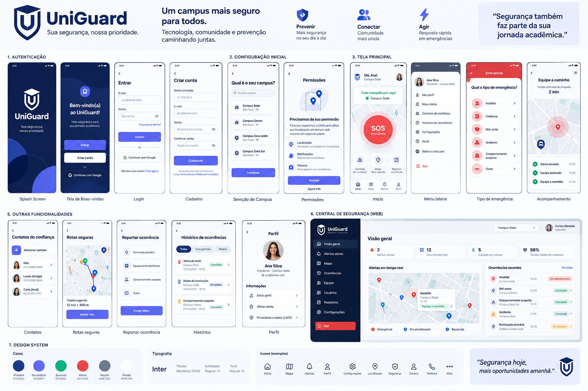
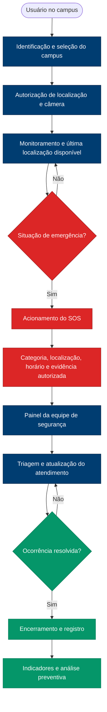

# 🛡️ UniGuard — Segurança Universitária Georreferenciada

> **Protótipo acadêmico em desenvolvimento.** O UniGuard não possui integração oficial com a Universidade Federal da Paraíba (UFPB), seus sistemas institucionais, a Superintendência de Segurança, o SAMU ou a Polícia Militar. Os dados, usuários, mapas, alertas e indicadores apresentados são fictícios e utilizados exclusivamente para demonstração.

O **UniGuard** é uma proposta de solução digital voltada ao apoio da segurança de estudantes, docentes e servidores em ambientes universitários. O projeto combina um aplicativo Android para acionamento de emergência, um protótipo web com visão do usuário e painel de segurança, geolocalização, registro de ocorrências e estruturas demonstrativas de dados.

🔗 **Protótipo web:** [Acessar o UniGuard](https://uniguardvercelapp.vercel.app/)

📄 **Apresentação profissional:** [Visualizar o PDF](UniGuard_Apresentacao_Profissional.pdf)

---

## 📱 Telas e protótipo no Figma

🔗 **Protótipo editável:** [Abrir o UniGuard no Figma](https://www.figma.com/design/HMchmhVu5HFhaoIdmP5p2q/UniGuard?node-id=0-1&p=f&m=draw)

🖼️ **Galeria completa:** [Visualizar as 15 telas individualmente](docs/prototipo-figma/README.md)



> A imagem acima reúne a visão geral do produto. A galeria apresenta separadamente as telas de acesso, configuração, SOS, acompanhamento e recursos complementares. O material representa a visão de produto e pode conter funcionalidades ainda em desenvolvimento.

---

## 🎯 Objetivo

Explorar como recursos de tecnologia, geolocalização e comunicação digital podem contribuir para o registro e o acompanhamento de situações de risco dentro de campi universitários, reduzindo etapas entre o pedido de ajuda e a visualização da ocorrência por uma equipe responsável.

---

## 💭 Por que criei o UniGuard

O UniGuard nasceu da observação de que determinados trajetos dentro de ambientes universitários podem gerar insegurança, especialmente para pessoas que precisam circular desacompanhadas. Campi extensos, áreas de preservação, iluminação insuficiente e caminhos com pouca circulação podem aumentar essa sensação de vulnerabilidade.

A proposta busca facilitar o pedido de ajuda e permitir que a equipe responsável receba informações essenciais, como localização e horário, com mais rapidez. O foco está principalmente em estudantes, servidores, mulheres, pessoas LGBTQIA+ e outros públicos que possam se sentir mais vulneráveis durante seus deslocamentos.

Essa motivação parte de uma percepção e de experiências de circulação no ambiente universitário. Ela não representa uma afirmação sobre índices oficiais de criminalidade da UFPB.

---

## 💡 Como a solução foi pensada

1. O usuário realiza sua identificação e escolhe o campus.
2. O dispositivo solicita autorização para utilizar localização e câmera.
3. Em uma situação de emergência, o usuário aciona o botão SOS.
4. O alerta reúne categoria, data, hora e localização disponível.
5. Quando autorizada, uma imagem pode ser associada ao registro da ocorrência.
6. O painel de segurança recebe ou simula o chamado para acompanhamento.
7. A equipe atualiza o status até a finalização do atendimento.
8. Os registros podem apoiar análises demonstrativas sobre ocorrências e pontos de atenção.

---

## ✅ O que já está presente no repositório

### Protótipo web

- Interface responsiva desenvolvida com React e TypeScript.
- Alternância entre **App do Usuário** e **Painel de Segurança**.
- Seleção demonstrativa dos campi da UFPB.
- Cadastro e identificação do usuário.
- Botão SOS e categorização de ocorrências.
- Uso da geolocalização disponibilizada pelo navegador.
- Registro da última localização disponível.
- Captura de imagem mediante permissão do usuário.
- Histórico e acompanhamento do status dos alertas.
- Mapa interativo e representação de pontos seguros.
- Inclusão de alertas simulados para demonstração do painel.
- Funcionamento local demonstrativo quando o Firebase não está configurado.

### Aplicativo Android

- Projeto Android nativo em Kotlin.
- Tela integrada de SOS.
- Permissões para localização, câmera, internet, SMS e vibração.
- Uso do Google Play Services Location e Google Maps.
- Estrutura preparada para Firebase Authentication, Firestore e Storage.
- Execução em modo demonstrativo sem o arquivo de configuração do Firebase.

### Dados e documentação

- Regras demonstrativas do Firestore e Firebase Storage.
- Orientações para configurar a comunicação entre Android e painel web.
- Modelo relacional MySQL 8+ com tabelas, relacionamentos, índices, views, trigger e dados fictícios.
- Base em Excel e arquivo CSV com dados simulados para análises.
- Apresentação profissional do conceito em PDF.

---

## 🚧 Funcionalidades planejadas

As funcionalidades abaixo representam possibilidades de evolução e não devem ser interpretadas como integrações operacionais disponíveis atualmente:

- autenticação com credenciais institucionais;
- comunicação oficial com a central de segurança da universidade;
- acompanhamento contínuo de localização em segundo plano;
- envio real de mensagens aos contatos de confiança;
- roteamento e despacho de equipes de segurança;
- integração com serviços públicos de emergência;
- implantação de uma API segura entre o aplicativo e um banco relacional;
- relatórios institucionais, mapas de calor e indicadores com dados reais autorizados;
- testes de segurança, privacidade, acessibilidade e desempenho em ambiente piloto.

---

## 📝 Validação com a comunidade universitária

Uma etapa futura prevê a aplicação de um questionário com estudantes e servidores para compreender a percepção de segurança no campus. A pesquisa poderá abordar condições de iluminação, circulação, horários, trajetos e locais considerados pontos de atenção.

As respostas poderão orientar melhorias no aplicativo e ajudar a avaliar se a solução atende a uma necessidade percebida pela comunidade. Enquanto a pesquisa não for realizada, o projeto não apresenta seus pressupostos como resultados comprovados.

---

## 🔀 Fluxograma conceitual

O fluxo abaixo representa a visão planejada para uma versão ampliada do UniGuard. Algumas etapas ainda dependem de integrações, autorizações institucionais e desenvolvimento adicional.



---

## 🧩 Arquitetura atual

| Camada | Tecnologias e finalidade |
|---|---|
| Protótipo web | React 19, TypeScript, Vite e Tailwind CSS |
| Mapas | Leaflet no protótipo web |
| Aplicativo móvel | Kotlin, Android SDK, Material Components e Google Maps |
| Geolocalização Android | Google Play Services Location |
| Sincronização opcional | Firebase Authentication, Firestore e Storage |
| Modelo relacional | MySQL 8+ para estudo e evolução futura |
| Hospedagem | Vercel |
| Dados demonstrativos | Excel e CSV com informações simuladas |

O aplicativo Android e o painel web podem compartilhar alertas pelo Firebase quando o ambiente é configurado. O modelo MySQL é uma alternativa arquitetural para evolução futura e deve ser acessado por uma API/backend, nunca diretamente pelo aplicativo.

---

## 📊 Apresentação e dados demonstrativos

Todos os dados disponibilizados nesta seção são fictícios e foram preparados exclusivamente para apresentação acadêmica do projeto.


- 📄 [Apresentação profissional — PDF](UniGuard_Apresentacao_Profissional.pdf)
- 📊 [Base demonstrativa para análise — Excel](UniGuard_Base_Demonstrativa_PowerBI.xlsx)
- 🗃️ [Dados simulados — CSV](UniGuard_Dados_Simulados_PowerBI.csv)
- 🖼️ [Prévia dos indicadores — PNG](UniGuard_Preview_PowerBI.png)

> Os arquivos Excel e CSV funcionam como base demonstrativa para construção e exploração de indicadores. O repositório não contém, neste momento, um arquivo `.pbix`.

---

## 🗄️ Banco de dados

O diretório [`UniGuard_Banco_MySQL`](UniGuard_Banco_MySQL/) contém um modelo relacional compatível com MySQL 8+, criado para representar usuários, dispositivos, campi, contatos de confiança, pontos seguros, alertas, localizações, evidências, equipes, despachos e auditoria.

Consulte as [instruções específicas do banco](UniGuard_Banco_MySQL/README_BANCO.md) antes da execução.

---

## 📁 Organização do repositório

```text
UniGuard/
├── app/                        # Aplicativo Android em Kotlin
├── docs/                       # Orientações, imagens e galeria do protótipo
├── src/                        # Protótipo web em React/TypeScript
│   ├── components/             # Telas, painéis e modais
│   ├── data/                   # Dados simulados dos campi
│   ├── services/               # Integração opcional com Firebase
│   └── utils/                  # Geolocalização, câmera e recursos auxiliares
├── UniGuard_Banco_MySQL/       # Modelo relacional e documentação do banco
├── UniGuard_Apresentacao_Profissional.pdf
├── UniGuard_Base_Demonstrativa_PowerBI.xlsx
├── UniGuard_Dados_Simulados_PowerBI.csv
├── UniGuard_Telas_Prototipo.png
└── UniGuard_Preview_PowerBI.png
```


## 🔐 Privacidade, segurança e LGPD

Uma solução de emergência lida com localização, imagem, identificação e outros dados potencialmente sensíveis. Uma implantação real exigiria, entre outras medidas:

- base legal e finalidade claramente definidas;
- consentimento e transparência quando aplicáveis;
- coleta mínima e retenção limitada dos dados;
- criptografia e controle de acesso por perfil;
- trilhas de auditoria e resposta a incidentes;
- testes técnicos e validação jurídica/institucional;
- regras específicas para acesso a imagens e localização;
- canal para exercício dos direitos dos titulares.

Não utilize dados pessoais reais durante testes públicos deste protótipo.

---

## 📌 Status do projeto

**Protótipo acadêmico avançado / MVP demonstrativo.** O repositório reúne aplicativo Android, painel web, regras de segurança, controle institucional, auditoria, políticas de retenção e documentação de implantação. A integração com o Firebase real e a validação ponta a ponta ainda dependem de configuração autorizada, testes controlados e aprovação institucional.

### Documentação de segurança

- [Modelo de segurança e governança](docs/SECURITY_GOVERNANCE.md)
- [Checklist de publicação do Firebase](docs/FIREBASE_DEPLOYMENT_CHECKLIST.md)
- [Estratégia de ambientes](docs/ENVIRONMENT_STRATEGY.md)
- [Backlog de hardening](docs/SECURITY_HARDENING_BACKLOG.md)

O projeto ainda não representa um serviço de emergência disponível para uso real.

---

## 👩‍💻 Autoria

**Priscilla Cahino**  
Idealização, concepção do produto e prototipação do UniGuard.

- [GitHub](https://github.com/Priscillacahino)
- [Portfólio profissional](https://portifoliocpriscillacom.vercel.app/)
- [LinkedIn](https://www.linkedin.com/in/priscilla-cahino-04a718aa/)

---

### Direitos e uso

O conteúdo autoral, a identidade visual e a documentação do UniGuard não estão autorizados para reprodução, comercialização ou uso institucional sem autorização prévia da autora. Bibliotecas, componentes e demais recursos de terceiros permanecem sujeitos às respectivas licenças.

Desenvolvido como projeto tecnológico e acadêmico em evolução, com finalidade demonstrativa. 🛡️
