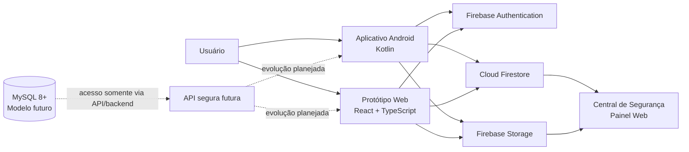
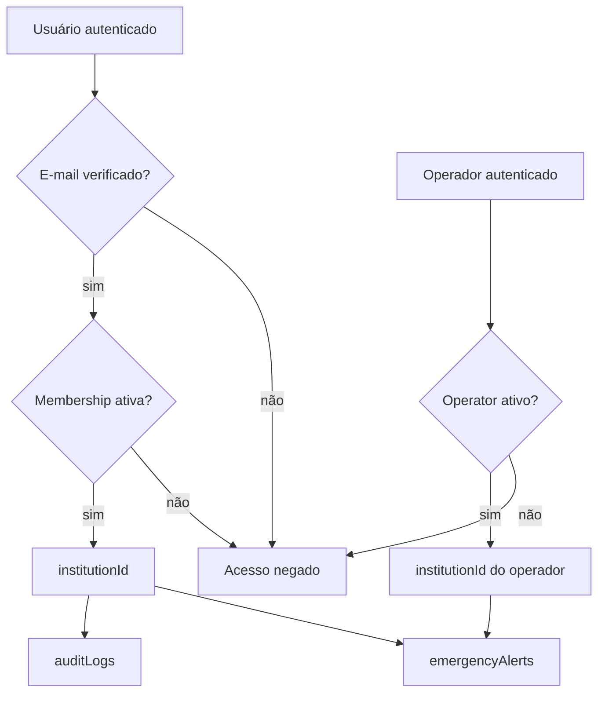
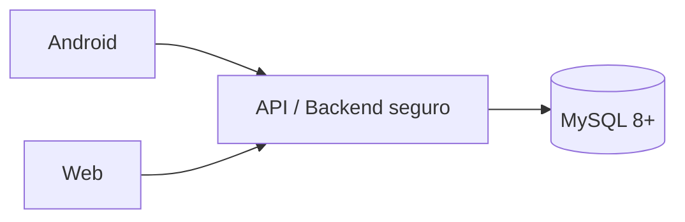
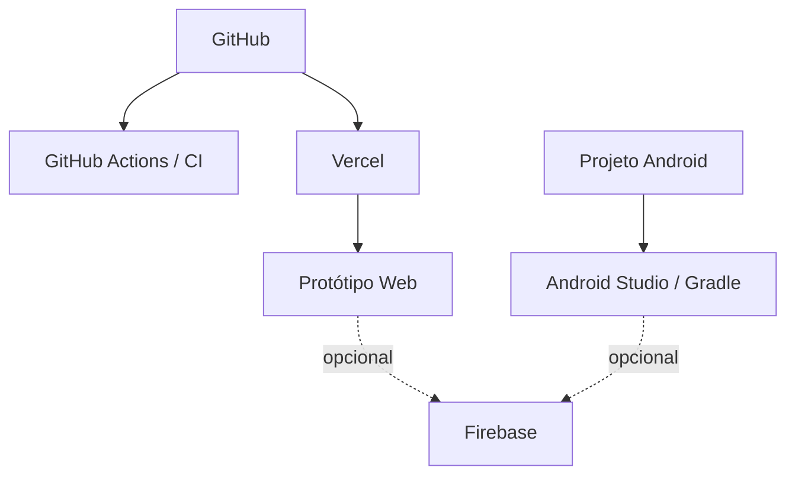

# Arquitetura do UniGuard

> Documento de arquitetura do **protótipo acadêmico UniGuard**. Esta documentação descreve o estado atual do repositório e separa explicitamente os componentes existentes das evoluções planejadas. O UniGuard não é, neste momento, um serviço oficial de emergência ou uma integração institucional da UFPB.

## 1. Visão geral

O UniGuard é estruturado em duas experiências principais:

- **Aplicativo Android**, desenvolvido em Kotlin, voltado ao usuário que pode acionar um alerta de emergência;
- **Aplicação web**, desenvolvida em React e TypeScript, que reúne a experiência demonstrativa do usuário e a visão da Central de Segurança.

Quando o Firebase está configurado, Android e web podem compartilhar autenticação, alertas, estados de atendimento, auditoria e evidências. Quando o Firebase não está configurado, o projeto mantém um modo demonstrativo local para apresentação acadêmica.



## 2. Componentes atuais

### 2.1 Aplicativo Android

**Tecnologias principais**

- Kotlin;
- Android SDK;
- Material Components;
- Google Maps;
- Google Play Services Location;
- integração preparada para Firebase Authentication, Firestore e Storage.

**Responsabilidades**

- autenticar o usuário quando o Firebase está disponível;
- solicitar permissões necessárias;
- obter a localização disponível;
- permitir o acionamento do SOS;
- categorizar a ocorrência;
- registrar evidência fotográfica quando autorizada;
- acompanhar o estado do alerta;
- aplicar controles locais de abuso;
- limpar dados temporários locais conforme a política definida.

O pacote Android utilizado no projeto é:

```text
com.priscillacahino.uniguard
```

### 2.2 Aplicação Web

**Tecnologias principais**

- React 19;
- TypeScript;
- Vite;
- Tailwind CSS;
- Leaflet;
- Firebase opcional.

**Responsabilidades**

- fornecer uma experiência demonstrativa do usuário;
- apresentar o Painel da Central de Segurança;
- exibir alertas autorizados para a instituição do operador;
- permitir acompanhamento e mudança de status;
- exibir mapas, localização e dados demonstrativos;
- operar em modo local quando o Firebase não está configurado.

A implantação web demonstrativa é hospedada na Vercel.

## 3. Firebase

### 3.1 Authentication

A identidade institucional utiliza **e-mail e senha**.

Para operar no fluxo institucional, não basta possuir uma credencial. O usuário precisa:

1. ter o e-mail confirmado;
2. possuir vínculo ativo em `memberships/{uid}`;
3. estar associado a uma `institutionId` autorizada.

Operadores utilizam `operators/{uid}` e também precisam estar ativos e vinculados à instituição correta.

Autenticação anônima não é tratada como identidade válida para alertas institucionais.

### 3.2 Firestore

O Firestore é a camada de sincronização operacional entre usuário e Central quando o Firebase está configurado.

Principais responsabilidades:

- alertas de emergência;
- status do atendimento;
- confirmação de recebimento;
- vínculos institucionais;
- operadores;
- trilhas de auditoria;
- campos de retenção.

O isolamento entre instituições é realizado por `institutionId`.



### 3.3 Storage

O Firebase Storage é utilizado para evidências autorizadas relacionadas às ocorrências.

Controles documentados:

- associação da evidência à instituição/alerta autorizado;
- bloqueio de sobrescrita da evidência pelo cliente;
- previsão de retenção de 30 dias;
- ciclo de vida remoto ainda precisa ser ativado e validado antes de piloto real.

## 4. Isolamento institucional

O UniGuard foi estruturado para permitir evolução para múltiplas instituições.

O campo central dessa separação é:

```text
institutionId
```

Ele é utilizado em usuários autorizados, operadores, alertas e registros de auditoria.

Princípio aplicado:

> Um usuário ou operador não deve ler, alterar, confirmar, administrar ou visualizar evidências pertencentes a outra instituição.

Documentos legados sem `institutionId` devem ser migrados ou isolados antes de qualquer piloto.

## 5. Auditoria

A coleção `auditLogs` registra eventos relevantes e foi projetada como **append-only para clientes**.

Eventos atualmente documentados:

- `alert_created`;
- `alert_received`;
- `alert_viewed`;
- `alert_status_changed`;
- `alert_cancelled_by_user`;
- `evidence_uploaded`.

Cada evento possui informações como instituição, alerta, ator e horário.

## 6. Retenção e minimização de dados

| Tipo de dado | Prazo definido no projeto | Situação |
|---|---:|---|
| Alertas no Firestore | 90 dias | campo de retenção previsto; TTL remoto deve ser ativado/validado |
| Auditoria | 365 dias | campo de retenção previsto; TTL remoto deve ser ativado/validado |
| Evidências no Storage | 30 dias | ciclo de vida remoto ainda precisa ser configurado/validado |
| Cache de alertas encerrados | 7 dias | limpeza local prevista/implementada |
| Fotos temporárias Android | 7 dias | limpeza local prevista/implementada |

O projeto não deve armazenar prontuário médico. O campo legado `medicalNotes` é rejeitado e dados clínicos desnecessários foram removidos da modelagem funcional.

## 7. Controle contra abuso

Na camada cliente, o projeto aplica:

- máximo de **1 alerta ativo por usuário**;
- máximo de **3 alertas em uma janela de 30 minutos**;
- intervalo mínimo de **60 segundos** entre novos alertas.

Esses controles melhoram a experiência e reduzem disparos repetitivos, mas não são considerados uma fronteira de segurança suficiente contra clientes adulterados.

Para um ambiente real, a arquitetura prevista inclui:

- Firebase App Check;
- criação/validação de alertas em função ou API confiável;
- rate limiting por usuário e contexto;
- análise de duplicidade e abuso no backend.

## 8. MySQL e evolução futura

O diretório `UniGuard_Banco_MySQL/` contém um modelo relacional para estudo e evolução do projeto.

O banco **não deve ser acessado diretamente pelo aplicativo ou navegador**.

Caso essa arquitetura seja adotada, o fluxo correto é:



A API deverá concentrar autenticação, autorização, validação, auditoria e regras de negócio aplicáveis ao acesso ao banco relacional.

## 9. Modo demonstrativo

O UniGuard mantém uma camada demonstrativa para permitir apresentação acadêmica sem exigir infraestrutura completa.

Nesse modo:

- os dados devem ser fictícios;
- não se deve simular uma integração institucional como se fosse real;
- a ausência de Firebase não deve ser confundida com ambiente de produção;
- nenhum dado pessoal real deve ser utilizado em demonstrações públicas.

## 10. Implantação atual



O CI valida aspectos do repositório, enquanto a Vercel hospeda a aplicação web demonstrativa.

## 11. Fronteiras de confiança

As principais fronteiras de segurança são:

1. **cliente ↔ Firebase Authentication** — comprovação da identidade;
2. **cliente ↔ Firestore/Storage** — autorização por regras;
3. **instituição A ↔ instituição B** — segregação obrigatória por `institutionId`;
4. **cliente ↔ futura API** — validação server-side para controles que não podem depender apenas do dispositivo;
5. **dados demonstrativos ↔ dados reais** — o repositório público/demonstrativo deve utilizar somente informações fictícias.

## 12. O que ainda falta antes de um piloto institucional

- validar ponta a ponta Android → Firebase → Central;
- executar testes negativos entre instituições;
- comprovar bloqueios para conta não verificada e vínculo inativo;
- ativar e validar TTL no Firestore;
- configurar e validar ciclo de vida do Storage;
- habilitar App Check;
- implementar rate limiting confiável no backend;
- formalizar procedimentos de exclusão, incidentes e exceções legais;
- realizar validação de segurança, privacidade, acessibilidade e desempenho;
- obter validações jurídicas, operacionais e institucionais aplicáveis.

## 13. Documentos relacionados

- [`../SECURITY.md`](../SECURITY.md) — política e postura de segurança;
- [`CONTROLES_AUDITORIA_RETENCAO_ABUSO.md`](CONTROLES_AUDITORIA_RETENCAO_ABUSO.md) — controles de auditoria, retenção e abuso;
- [`FIREBASE_SETUP.md`](FIREBASE_SETUP.md) — configuração do Firebase;
- [`../CHANGELOG.md`](../CHANGELOG.md) — evolução do projeto;
- [`apresentacao/UniGuard_Apresentacao_Profissional.pdf`](apresentacao/UniGuard_Apresentacao_Profissional.pdf) — apresentação profissional consolidada.

---

## Responsabilidade geral

**Priscilla Cahino** — responsável geral pelo projeto UniGuard, abrangendo idealização, concepção do produto, definição da proposta de valor, estruturação de fluxos, requisitos e regras de negócio, prototipação, documentação, organização dos artefatos e consolidação do projeto acadêmico.
