# Protótipo de interface - UniGuard

Estas telas apresentam a proposta visual e a jornada planejada para o aplicativo móvel UniGuard. O material é um protótipo acadêmico e pode representar funcionalidades ainda não implementadas.

- [Abrir o protótipo no Figma](https://www.figma.com/design/HMchmhVu5HFhaoIdmP5p2q/UniGuard?node-id=0-1&p=f&m=draw)
- Autoria e prototipação: **Priscilla Cahino**

## Acesso e configuração

| Abertura | Boas-vindas | Entrar |
|---|---|---|
| 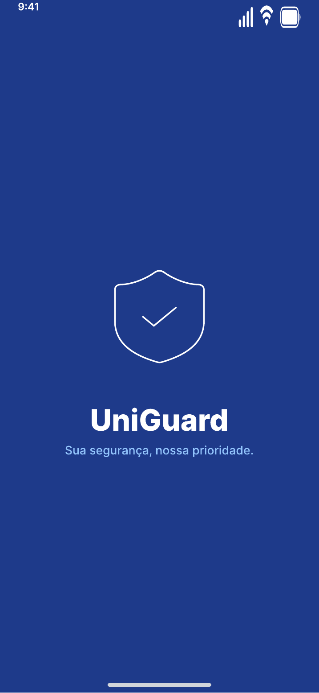 | 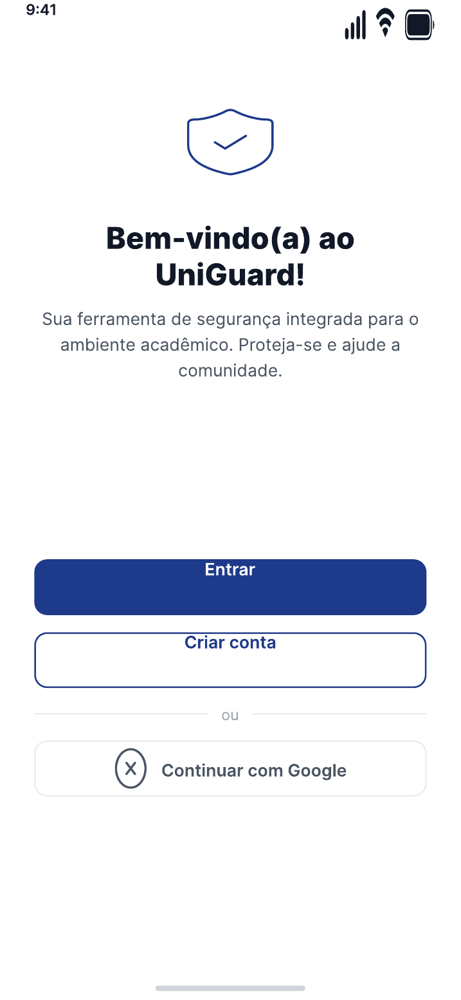 | 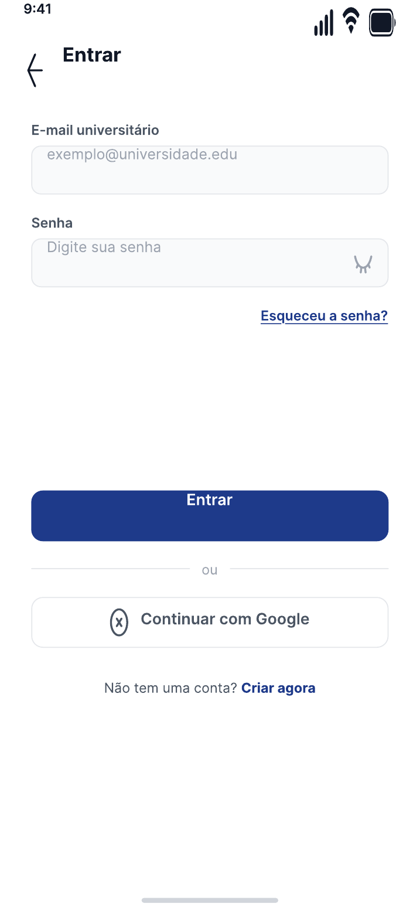 |

| Criar conta | Selecionar campus | Permissões |
|---|---|---|
| 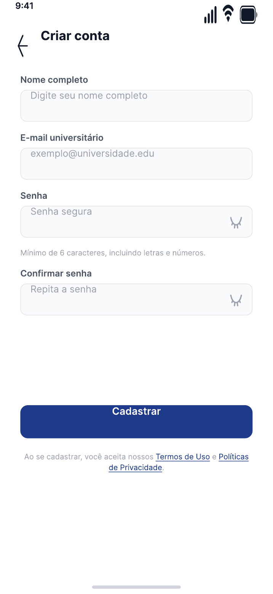 | 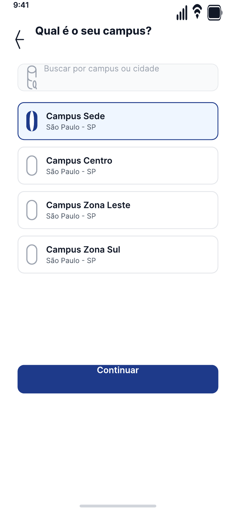 | 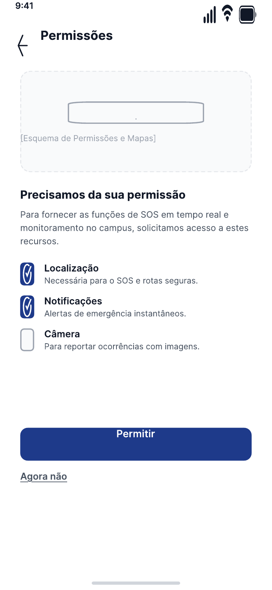 |

## Emergência e acompanhamento

| Início e SOS | Menu | Emergência |
|---|---|---|
| 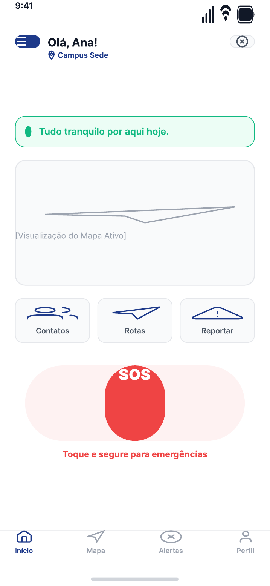 | 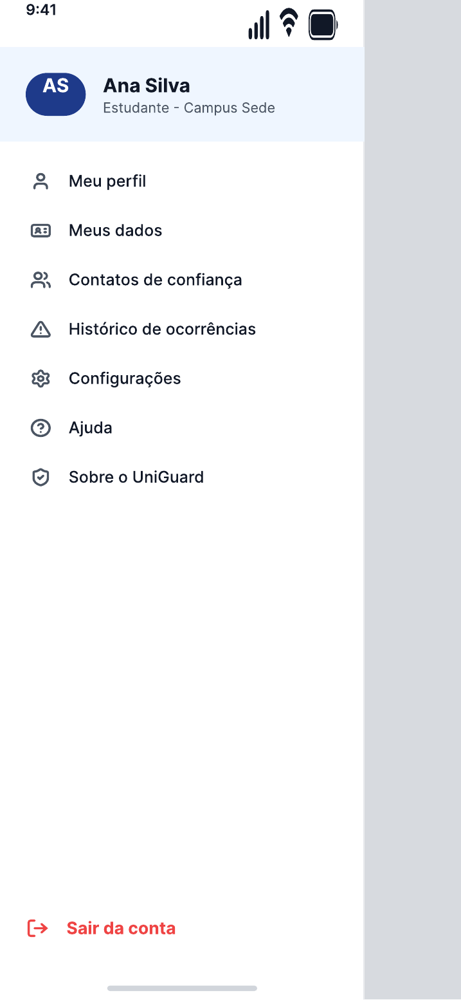 | 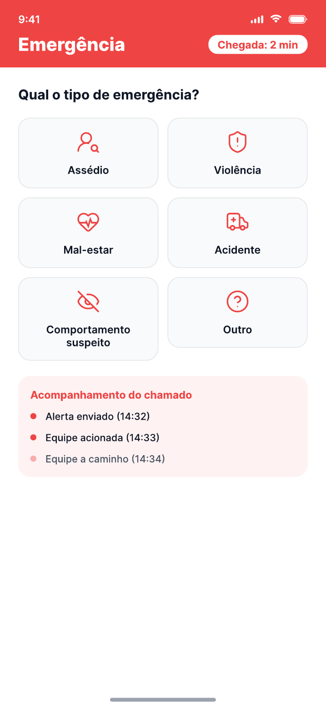 |

| Equipe a caminho |
|---|
| 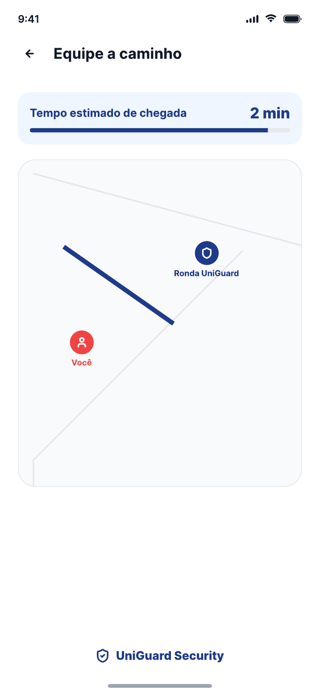 |

## Recursos complementares

| Contatos de confiança | Rotas seguras | Reportar ocorrência |
|---|---|---|
| 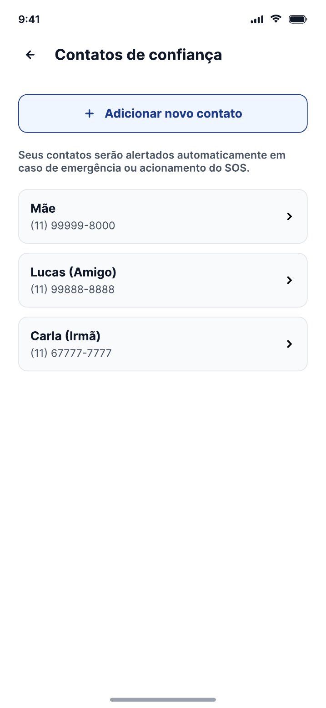 | 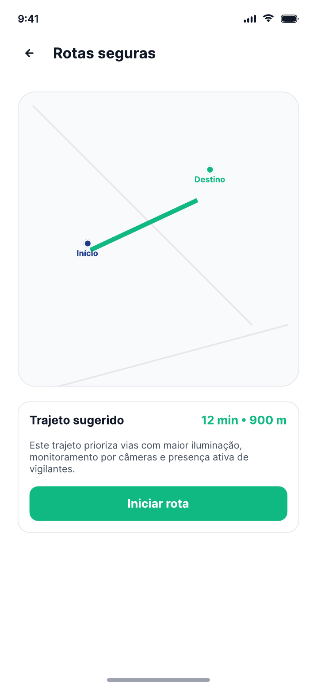 | 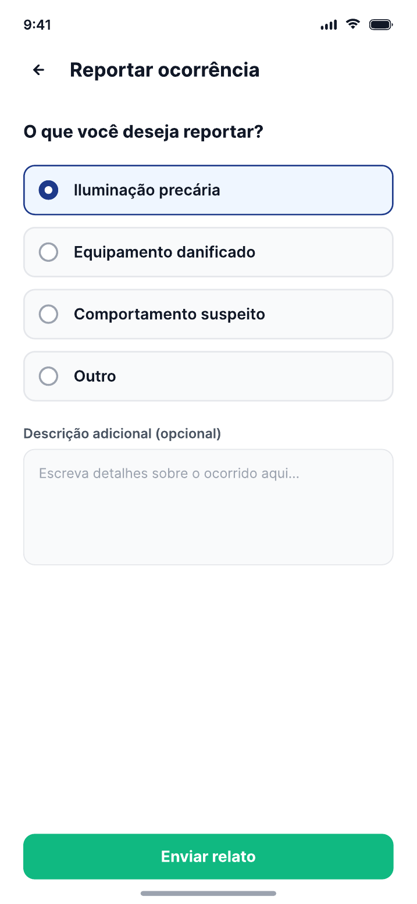 |

| Histórico de ocorrências | Perfil |
|---|---|
| 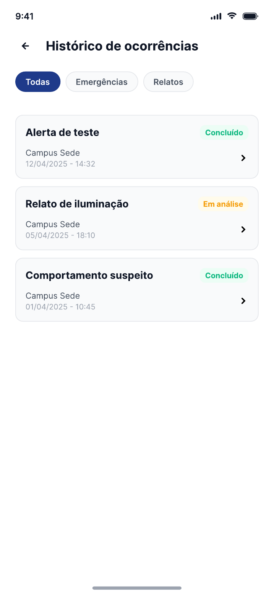 | 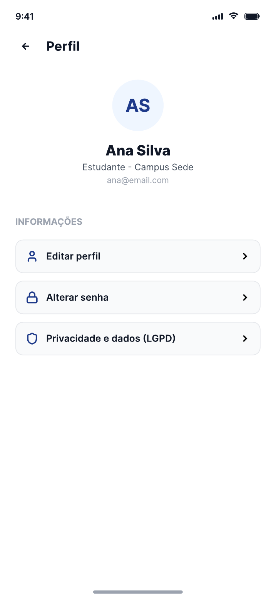 |

> As informações, nomes, campi, ocorrências e tempos apresentados nas telas são demonstrativos.
